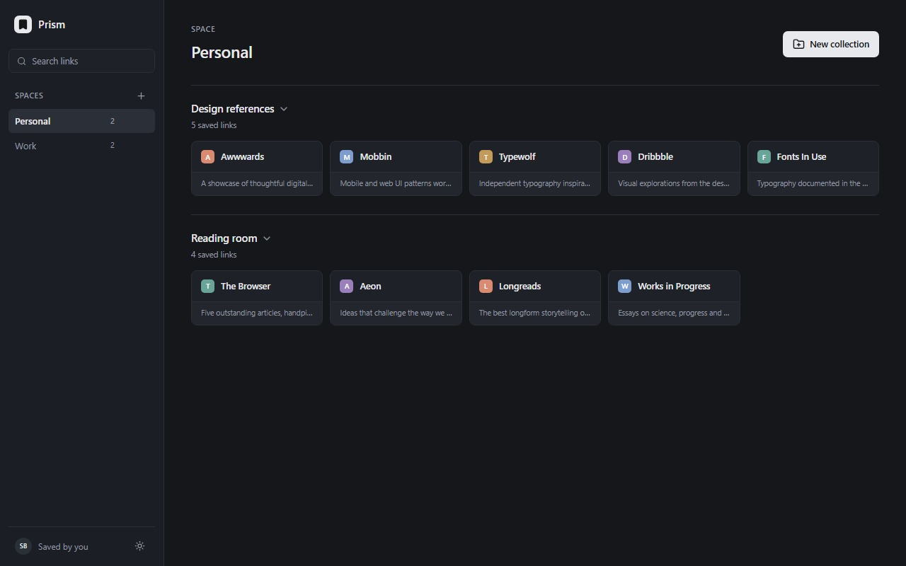

# Prism Bookmarks

A Chrome extension (Manifest V3) that turns your bookmarks into a visual dashboard. Links live as cards grouped into collections, and collections are grouped into spaces.



## Features

- **Spaces → Collections → Links**, a two-level hierarchy for separating contexts
- Cards show the site favicon, a title, and a short description
- Create, rename, and delete spaces, collections, and links
- Drag and drop to reorder collections and the links inside them
- Collapse a collection to tuck it away
- Instant search across link titles and descriptions
- Dark and light themes, dark by default

## Privacy

The extension requests only the `favicon` permission and makes **no network requests**. Bookmarks are stored locally in IndexedDB; the theme preference lives in local storage. Nothing is sent anywhere.

Site icons come from Chrome's local favicon cache via the `_favicon` API. The dev server falls back to a public favicon service, and that branch is stripped from production builds.

## Tech stack

- React 19 + TypeScript
- Vite with `vite-plugin-web-extension`
- Tailwind CSS v4
- Native IndexedDB API (no storage dependencies)

## Development

```bash
npm install
npm run dev
```

The dev server runs the dashboard as a normal web page. Chrome extension APIs are unavailable there, so favicons use the fallback source.

## Build and install

```bash
npm run build
```

Then load it in Chrome:

1. Open `chrome://extensions`
2. Enable **Developer mode**
3. Choose **Load unpacked** and select the `dist` folder
4. Click the Prism icon to open the dashboard in a tab

## Packaging

```bash
npm run package   # builds and writes prism-bookmarks.zip for the Chrome Web Store
npm run icons     # regenerates the PNG icon set
```

Store screenshots in `screenshots/` are generated by `node scripts/screenshots.mjs` against a running preview server.

## License

Apache License 2.0 — see [LICENSE](LICENSE).
